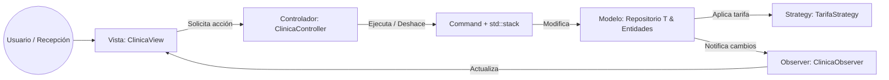

# 🏥 Sistema Integral de Gestión Clínica (`ClinicaMVC-CPP`)

> **Asignatura:** Tecnología de Objetos — Ingeniería de Sistemas (UNSA)  
> **Docente:** Mg. Diego Alonso Iquira Becerra  
> **Lenguaje:** C++ (Estándar C++17)  
> **Arquitectura y Paradigma:** Modelo-Vista-Controlador (MVC), Principios SOLID, Patrones de Diseño y Programación Genérica  

---

## 📋 1. ¿De qué trata el proyecto?

**ClinicaMVC-CPP** es una aplicación modular desarrollada en **C++** que simula el flujo operativo, clínico y de facturación de un centro médico. El proyecto resuelve problemas reales de acoplamiento, gestión de memoria, escalabilidad y control de errores mediante una arquitectura limpia que combina el patrón **MVC**, patrones de diseño comportamentales, estructuras de datos dinámicas (`std::stack`, `std::vector`) y características avanzadas de C++ moderno[cite: 1, 2, 3].

---

## 🎯 2. ¿Qué funcionalidades tendrá el sistema?

1. **Gestión de Registros Clínicos y Especialidades:** Creación y clonación de consultas generales y especializadas (Cardiología, Pediatría, etc.) aplicando herencia, polimorfismo y retorno covariante.
2. **Fusión de Historiales y Auditoría Médica:** Unificación de múltiples consultas de un mismo paciente mediante sobrecarga de operadores (`+`) y acceso controlado a diagnósticos confidenciales mediante funciones `friend`.
3. **Facturación Dinámica según Seguro:** Cálculo automático de tarifas y descuentos en tiempo de ejecución (Particular, Seguro Privado, Seguro SIS) evitando condicionales rígidos (`if`/`switch`)[cite: 3].
4. **Sistema de Alertas en Tiempo Real:** Notificación automática simultánea al panel médico, caja y auditoría cada vez que se registra una consulta o cambia el estado de un paciente[cite: 3].
5. **Historial con Función Deshacer (`Ctrl + Z`):** Reversión segura de la última operación registrada (como errores de digitación en recepción) mediante comandos encapsulados en una pila LIFO (`std::stack`)[cite: 1, 3].
6. **Reportes Filtrados y Persistencia:** Filtrado rápido de cobros elevados con expresiones Lambda y almacenamiento permanente en archivos `.csv` / `.txt` mediante `<fstream>`[cite: 2].

---

## 🏗️ 3. Arquitectura del Sistema (MVC + Patrones en C++)

El sistema separa estrictamente la interfaz de consola, la lógica médica y el control de flujo bajo el patrón arquitectónico **Modelo-Vista-Controlador (MVC)**[cite: 2]:



### Estructura de Directorios

```text
ClinicaMVC-CPP/
├── include/
│   ├── model/
│   │   ├── RegistroClinico.hpp         # Clase base (Herencia, virtual, inline, const)
│   │   ├── RegistroEspecializado.hpp   # Subclase con retorno covariante en clonar()
│   │   ├── HistorialMedico.hpp         # Encapsulamiento, friend y operator+
│   │   └── Repositorio.hpp             # Clase plantilla genérica template <typename T>
│   ├── strategy/
│   │   ├── TarifaStrategy.hpp          # Clase abstracta pura (Interfaz Strategy)
│   │   ├── TarifaParticular.hpp        # 0% descuento
│   │   ├── SeguroPrivado.hpp           # 20% descuento
│   │   └── SeguroSIS.hpp               # 50% descuento
│   ├── observer/
│   │   ├── ClinicaObserver.hpp         # Interfaz Observer
│   │   ├── ClinicaSubject.hpp          # Sujeto observable
│   │   ├── PanelMedicoObserver.hpp     # Observador: Área Médica
│   │   └── AuditoriaObserver.hpp       # Observador: Auditoría Clínica
│   ├── command/
│   │   ├── Command.hpp                 # Interfaz Command (ejecutar / deshacer)
│   │   ├── RegistrarConsultaCommand.hpp
│   │   └── HistorialComandos.hpp       # Invoker con std::stack<Command*> (Ctrl + Z)
│   ├── exception/
│   │   └── ExcepcionesClinica.hpp      # Excepciones personalizadas (std::runtime_error)
│   ├── persistence/
│   │   └── ArchivoClinicoService.hpp   # Persistencia con std::ifstream / std::ofstream
│   ├── view/
│   │   └── ClinicaView.hpp             # Interfaz de usuario en consola
│   └── controller/
│       └── ClinicaController.hpp       # Orquestador MVC
├── src/
│   └── main.cpp                        # Punto de entrada y gestión de ciclo de vida
└── README.md                           # Documentación para GitHub Pages
```

---

## 🧩 4. Aplicación de Conceptos del Curso (¿Qué usamos y para qué?)

| Concepto / Característica C++ | Implementación en `ClinicaMVC-CPP` | Propósito en el Sistema |
| :--- | :--- | :--- |
| **Patrón Arquitectónico MVC** | Capas separadas `model`, `view` y `controller`[cite: 2] | Desacopla la entrada/salida de consola (`std::cout`/`std::cin`) de las reglas de negocio y almacenamiento[cite: 2]. |
| **Patrón Strategy** | Clase abstracta `TarifaStrategy` + estrategias concretas[cite: 3] | Intercambia algoritmos de cálculo de costos y descuentos en tiempo de ejecución mediante polimorfismo[cite: 3]. |
| **Patrón Observer** | `ClinicaSubject` + vector de `ClinicaObserver*`[cite: 3] | Implementa comunicación uno-a-muchos: al registrar una consulta crítica, avisa al médico y a auditoría automáticamente[cite: 3]. |
| **Patrón Command + `std::stack`** | `Command` (`ejecutar()`, `deshacer()`) + `std::stack<Command*>`[cite: 1, 3] | Convierte cada acción en objeto[cite: 3]; se apila con `push()` y se revierte con `pop()` al ejecutar **Deshacer (`Ctrl + Z`)**[cite: 1]. |
| **Templates (`template <typename T>`)** | Clase genérica `Repositorio<T>`[cite: 2, 3] | Reutiliza la misma lógica de almacenamiento y búsqueda para `HistorialMedico` y `RegistroClinico` sin duplicar código[cite: 2, 3]. |
| **Covarianza y Contravarianza** | `RegistroEspecializado* clonar() const override` y `std::function` | La covarianza devuelve el puntero derivado exacto al clonar; la contravarianza permite usar un validador base sobre clases hijas. |
| **Optimización y Encapsulamiento C++** | `inline`, métodos `const`, `friend` y `operator+` | Acelera getters (`inline`), protege lecturas (`const`), autoriza auditorías privadas (`friend`) y fusiona consultas (`+`). |
| **Expresiones Lambda** | `std::for_each` / `std::copy_if` con captura `[limite]` | Filtra en línea los tratamientos que superan un monto específico sin crear funciones auxiliares externas. |
| **Manejo de Excepciones** | `try-catch-throw` con `std::invalid_argument` / `std::out_of_range`[cite: 1] | Valida costos positivos y limpia el buffer de `std::cin` ante entradas erróneas para evitar bloqueos[cite: 1]. |
| **Persistencia en Archivos** | `<fstream>` (`ofstream` / `ifstream`)[cite: 2] | Guarda y recupera los registros clínicos en un archivo `.csv` o `.txt` al iniciar y cerrar el programa[cite: 2]. |

---

## 🛡️ 5. Cumplimiento de Principios SOLID en C++

* **S — Responsabilidad Única (SRP):** Cada clase tiene una única responsabilidad (`ClinicaView` solo gestiona consola, `ArchivoClinicoService` solo opera archivos, `ClinicaController` solo coordina el flujo)[cite: 2].
* **O — Abierto/Cerrado (OCP):** El sistema permite incorporar nuevos convenios de seguro (`TarifaStrategy`) o nuevos canales de notificación (`ClinicaObserver`) agregando clases nuevas sin modificar el código existente[cite: 3].
* **L — Sustitución de Liskov (LSP):** Cualquier subclase (`RegistroEspecializado`) puede utilizarse a través de punteros o referencias de su clase base (`RegistroClinico*`) sin alterar la integridad del sistema.
* **I — Segregación de Interfaces (ISP):** Se definen clases abstractas puras pequeñas y cohesivas (`TarifaStrategy`, `ClinicaObserver`, `Command`) con métodos virtuales puros específicos[cite: 3].
* **D — Inversión de Dependencias (DIP):** Los módulos de alto nivel (`ClinicaController`) dependen de abstracciones (punteros/referencias a interfaces) y no de clases concretas.

---

## 📅 6. Plan de Desarrollo (Hoja de Ruta)

### Fase 1: Avance Arquitectónico (Presentación Actual)
- [x] Estructura modular del proyecto en C++ bajo arquitectura **MVC**[cite: 2].
- [x] Jerarquía clínica con `inline`, `const`, `friend`, `operator+` y **Covarianza**.
- [x] Implementación funcional de **Strategy** (cálculo de tarifas por seguro)[cite: 3].
- [x] Implementación funcional de **Observer** (alertas automáticas al registrar consultas)[cite: 3].
- [x] Validación robusta de entradas con manejo de **Excepciones** (`try-catch-throw`)[cite: 1].

### Fase 2: Entrega Final (Sistema Completo)
- [ ] Integración del patrón **Command** combinado con **`std::stack`** para soporte de **Deshacer (`Ctrl + Z`)**[cite: 1, 3].
- [ ] Implementación del **`Repositorio<T>` genérico** con `template <typename T>`[cite: 2, 3].
- [ ] Módulo de reportes con **Expresiones Lambda** y **Contravarianza** (`std::function`).
- [ ] Persistencia completa de datos mediante lectura y escritura en archivos `.csv` con `<fstream>`[cite: 2].

---

## 🚀 7. Compilación y Ejecución

```bash
# 1. Clonar el repositorio
git clone [https://github.com/tu-usuario/ClinicaMVC-CPP.git](https://github.com/tu-usuario/ClinicaMVC-CPP.git)
cd ClinicaMVC-CPP

# 2. Compilar con estándar C++17
g++ -std=c++17 -Wall -Iinclude src/main.cpp -o ClinicaMVC

# 3. Ejecutar la aplicación
./ClinicaMVC
```
